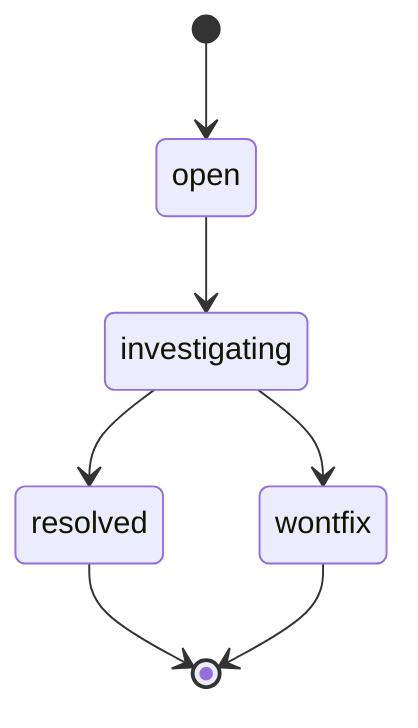

# nh-reader — 🐛 Bug Tracker

> 🐛 **Living Source of Truth**: Active tracking ledger for open bugs, quirks, external limitations, and resolution history for **NH Reader** (`nh-reader`).
> Pair with [`ROADMAP.md`](./ROADMAP.md) (direction), [`PLAN.md`](./PLAN.md) (sprints), and [`TODO.md`](./TODO.md) (tasks).

> [!IMPORTANT]
> All known bugs are listed here. AI agents are strictly required to update this page **before** working on any new bug fixes or features and keep it synchronized.

---

## 📜 Tracking Rules

- **100% Active Direction Accuracy**: `BUGS.md` and `.github/BUGS-ARCHIVE.md` must reflect the current active direction with zero contradictions. Immediately update or remove any quirk or bug entry superseded by a new architectural decision.
- **Zero External Mentions**: Never directly mention by name any external, third-party, or deleted projects or repositories.
- **No Typo Duplication**: When recording user reports, clean and fix all typos to preserve professional quality.
- **Explicit Project Tagging**: Every quirk, open bug, and resolved bug entry header MUST be prefixed with `[nh-reader]`.
- **Bare Minimal Root & Normalized Archive**: Keep this file focused on active issues and current architectural invariants; move detailed post-mortems of resolved bugs to `.github/BUGS-ARCHIVE.md` when it accumulates.

---

## 📖 Legend

### 🚦 Status
- ⚠️ **open** — reproducible, needs fixing *(include steps to reproduce and expected vs actual behavior)*.
- 🚧 **investigating** — repro/root-cause in progress.
- 🚫 **wontfix** — accepted limitation.
- ✅ **resolved** — verified and fixed.

### 🚨 Severity
- 🔴 **Critical**: app crashes, data loss, or total unreadability.
- 🟠 **High**: major usability, aesthetics, or state-synchronization issues.
- 🟡 **Medium**: minor alignment, non-critical state transitions, or fallbacks.
- 🟢 **Low**: minor warnings or cosmetic quirks.

---

## 🔄 Bug Lifecycle

---

## 🚫 Known Quirks & External Limitations (wontfix bucket)

- 🐢 **`[nh-reader]` Upstream API rate limiting (429s)**: The upstream API throttles rapid bursts. The Rust client throttles requests; the UI backs off gracefully.
- 🖼️ **`[nh-reader]` Image CDN 404s**: Legacy galleries occasionally return 404s on upstream image hosts. Mitigated via proxy fallback (`proxy_image`) and graceful placeholder rendering.
- 🔒 **`[nh-reader]` Single-instance enforcement**: Running a second instance focuses the existing window by design.
- 🔍 **`[nh-reader]` Search semantics**: Syntax and range logic follow upstream query semantics.
- 🔐 **`[nh-reader]` Code signing identity**: Automated CI release packaging does not publish unsigned or self-signed release binaries without a trusted organization certificate. Local signing is available via `npm run sign`.

---

## 💡 Explicitly Not Bugs

- 💡 **`[nh-reader]` Blacklisted galleries accessible via direct link**: Blacklists govern search discovery, grids, and feeds, but do not prevent opening direct gallery URLs.

---

## ⚠️ Active & Open Bugs

_No known open bugs._

---

## ✅ Closed & Resolved Bugs

### 2026-10-02 — `[nh-reader]`: Blacklist page filling & dynamic stream buffer (v0.7.4)
- **Severity**: 🟠 High
- **Status**: ✅ resolved (v0.7.4)
- **Root Cause**: Blacklist filtering could leave server pages partially empty, producing gaps in grids.
- **Fix**: Added continuous stream backfilling (`streamBackfilledList` in `src/lib/api.ts`) and reactive re-streaming via `blacklistVersion`.

### 2026-10-02 — `[nh-reader]`: NSIS installer finish-page text legibility (v0.7.5)
- **Severity**: 🟡 Medium
- **Status**: ✅ resolved (v0.7.5)
- **Root Cause**: v0.7.4's dark installer palette produced dark-on-dark text; the per-page MUI hooks used never executed.
- **Fix**: Reverted the finish page to the stock NSIS/MUI palette while keeping the branded sidebar bitmap.

### 2026-10-02 — `[nh-reader]`: NSIS Korean language fallbacks (v0.7.4)
- **Severity**: 🟢 Low
- **Status**: ✅ resolved (v0.7.4)
- **Root Cause**: Missing Korean translations produced NSIS build warnings and English fallbacks.
- **Fix**: Added Korean translations to `hooks.nsh`.

---

## 🔖 Metadata

- **Project**: nh-reader
- **Tracking Mode**: SemVer (`vMAJOR.MINOR.PATCH`)
