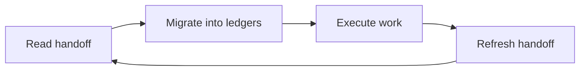

# HANDOFF.md — nh-reader Session Handoff

**Last updated:** 2026-10-19
**Current session status:** Delivered · 0 open workstreams
**Project:** nh-reader
**Root:** projects/nh-reader

> Permanent, git-tracked session-state ledger. Maintained **incrementally** — refresh at every
> workstream state change, fully rewrite at session end / soft-target posture. New session: read
> this file right after `AGENTS.md`, migrate every item into `ROADMAP.md` / `PLAN.md` /
> `TODO.md` / `BUGS.md`, then **refresh this file** (migrated-only state collapses to one-line
> delivered notes). **Never delete it.**

The session cycle every agent follows:

---

## 1) `[nh-reader]` Project-Local Ecosystem & Tracking Migration (Delivered)
- **State:** The repository is self-contained: it ships its own agents ecosystem, complete
  community-health suite, and repo-local tracking ledgers.
- **Delivered:**
  - `AGENTS.md`, `.agents/rules/local-conventions.md`, `.github/copilot-instructions.md`
  - `CODE_OF_CONDUCT.md`, `SUPPORT.md`, `GOVERNANCE.md`, `.github/pull_request_template.md`
  - `ROADMAP.md`, `PLAN.md`, `TODO.md`, `BUGS.md`, `HANDOFF.md`
  - Refreshed stale repository URLs and external references in `CONTRIBUTING.md`, `SECURITY.md`,
    `PRIVACY.md`, `TOS.md`, `CITATION.cff`, `.github/ISSUE_TEMPLATE/config.yml`, and `README.md`.
- **Next tasks:**
  - [ ] Select the first Milestone M13 backlog item from `TODO.md` (Tag Frequency Analytics).
- **Ledgers:** `TODO.md` (W.01 completed), `PLAN.md` (Sprint 1 completed)

---

## 2) `[nh-reader]` Milestone M13 — Post-v0.7.5 Enhancements (Planned)
- **State:** Backlog defined; no active sprint.
- **Delivered:** Nothing yet.
- **Next tasks:**
  - [ ] Tag frequency analytics from local reading history.
  - [ ] Multi-profile library partitions (isolated blacklist/favorite stores).
  - [ ] Background update inspection and release notification.
  - [ ] Unified `main:sub:option` / `.mjs` maintenance scripts standard.
- **Ledgers:** `ROADMAP.md` (M13), `PLAN.md` (Sprint 2), `TODO.md` (M13 candidates)

---

## 3) `[nh-reader]` Milestone M14 — Native C++ Windows Architecture & Scope Reduction (Future Planning)
- **State:** Architecture planning; queued for future implementation (other projects prioritized first).
- **Core Pivot:** Convert from Tauri v2 into a pure native C++20 Win32 desktop application and reduce scope purely to Windows (eliminating Android and POSIX targets for zero-overhead performance, instant startup, Direct2D/WinUI 3 rendering, and native throttled WinHTTP pipeline).
- **Ledgers:** `ROADMAP.md` (M14), `PLAN.md` (Sprint 3), `TODO.md` (M14 candidates)

---

## N) Shell / Tooling Notes
- Non-interactive shell policy active (no pagers/editors, fail-fast); use file editing tools.
- Node v26+ runs `.ts` scripts natively via type stripping; run CLI modules as `node <file>.ts`.
- PowerShell-aware quoting is required for paths with spaces.

---

## Quick Resume Checklist (New Session)
1. Read `AGENTS.md`
2. Read this file immediately, then `ROADMAP.md` → `PLAN.md` → `TODO.md` → `BUGS.md`
3. Migrate this file's open items into the ledgers, then refresh it (never delete)
4. Open `src-tauri/src/lib.rs`, `src/lib/api.ts`, and `CONTRIBUTING.md` for the current architecture and workflow
5. Resume at the first unchecked `TODO.md` item
6. Run the context-pressure scoreboard at every checkpoint — never wait for the user to flag a limit
