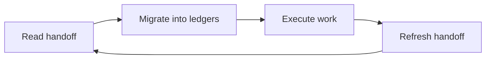

# HANDOFF.md — nh-reader Session Handoff

**Last updated:** 2026-10-28
**Current session status:** Sprint 2 Completed · v0.8.0 Staged & Verified · Ready for Commit & Push
**Project:** nh-reader
**Root:** projects/nh-reader

> Permanent, git-tracked session-state ledger. Maintained **incrementally** — refresh at every
> workstream state change, fully rewrite at session end / soft-target posture. New session: read
> this file right after `AGENTS.md`, migrate every item into `ROADMAP.md` / `PLAN.md` /
> `TODO.md` / `BUGS.md`, then **refresh this file** (migrated-only state collapses to one-line
> delivered notes). **Never delete it.**

The session cycle every agent follows:

---

## 1) `[nh-reader]` Sprint 2: Tauri v2 Performance Optimization & Browse/Navigation Modernization (Completed)
- **State:** Sprint 2 optimizations, navigation overhaul, reader polish, i18n parity, documentation suite, and release staging are fully completed and verified.
- **Delivered Scope:**
  - **SQLite Engine (`db.rs`)**: Configured WAL journal mode, `synchronous = NORMAL`, in-memory temp store, 64 MB page cache, 256 MB memory-mapped I/O, and added index on `kv(updated_at)` for instant cache pruning.
  - **Download & ZIP/CBZ Streaming (`service.rs`)**: Switched archive packing to `Stored` compression to skip redundant JPEG/WebP deflation (5x-10x faster download finalization with low CPU usage).
  - **Archive Page Count Cache (`commands.rs`)**: Cached page count in SQLite on first read, eliminating heavy synchronous disk I/O and zip directory inflation when opening the Downloads view.
  - **Memory & DOM Virtualization (`image.ts`, `GalleryGrid.svelte`, `CoverImage.svelte`, `ReaderImage.svelte`)**: Bounded in-memory object URL cache with LRU eviction (cap at 150 items) to prevent webview memory leaks, added keyed each loops `(g.id)` to avoid card DOM thrashing, and added `decoding="async"` to all images.
  - **Blacklist Tag Button-Chip Grid & Alphabetical Ordering (`BlacklistView.svelte`)**: Re-architected tag options into a responsive multi-column grid with squared button chips (`border-radius: var(--radius-sm, 6px)`), distinct tactile surface shading (`var(--surface-hover)`), wide layout (`max-width: 1400px`), and default alphabetical (`A–Z`) ordering with an interactive sort toggle.
  - **Modular SCSS Architecture (`src/styles/`)**: Installed `sass-embedded`, retired the monolithic 2,300-line `app.css`, structured modular SCSS partials (`_tokens.scss`, `_mixins.scss`, `_tags.scss`, `_base.scss`, `_components.scss`, `_layout.scss`, and `views/*`), and wired `$styles` path alias.
  - **Browse Navigation & Popularity Sorting Pivot (`+layout.svelte`, `+page.svelte`, `popular/+page.svelte`, `_browse.scss`)**: Retired the separate `/popular` tab from bottom navigation dock, renamed "Latest" to "Browse" with a `compass` icon, implemented tabbed popularity sorting (`Newest`, `Popular (All Time)`, `Popular This Week`, `Popular Today`), set up automatic redirect from legacy `/popular`, and added a "Random Doujin" button backed by `api.randomGallery()` and `fetch_random_id` with 100% blacklist compliance.
  - **Details View Hierarchical Up Navigation & Button Integration (`navigation.svelte.ts`, `+layout.svelte`, `[id]/+page.svelte`)**: Built dedicated origin-listing tracking via SvelteKit `afterNavigate` and `sessionStorage`. When viewing a doujin, the Back button in the actions row acts as an "Up" button returning to the originating listing (preserving pagination, queries, and scroll position). Restored global container frame padding.
  - **Reader Legibility & Containment (`_reader.scss`, `reader/+page.svelte`)**: Removed top gradient, anchored viewport below top bar (`top: 48px`, `z-index: 100`), auto-hide bottom dock.
  - **Full Documentation Suite (`docs/`)**: 11 user guides (`docs/user/*`) and 10 developer guides (`docs/developer/*`), with clean index in `docs/README.md`.
  - **Internationalization (i18n)**: 100% key parity across all 17 community packs (292/292 keys).
  - **Release Preparation (`v0.8.0`)**: Bumped version manifests, updated `.github/workflows/release.yml`, authored `CHANGELOG.md` entry, `.github/releases/v0.8.0.md`, and `.github/discussions/announcements/v0.8.0.md`.
- **Verification:**
  - `npm run check:i18n`: 292/292 keys verified OK across 17 community packs.
  - `npm run check`: 0 errors, 0 warnings.
  - `npm run build`: built production static bundle in 10.79s with 0 errors and 0 warnings.
  - `cargo test`: 7/7 unit tests verified.
- **Ledgers:** `ROADMAP.md` (M13 shipped), `PLAN.md` (Sprint 2 completed), `TODO.md` (v0.8.0 ready).

---

## N) Shell / Tooling Notes
- Non-interactive shell policy active (no pagers/editors, fail-fast); use file editing tools.
- Node v26+ runs `.ts` scripts natively via type stripping; run CLI modules as `node <file>.ts`.
- PowerShell-aware quoting is required for paths with spaces.

---

## Quick Resume Checklist (New Session)
1. Read `AGENTS.md`
2. Read this file immediately, then `ROADMAP.md` → `PLAN.md` → `TODO.md` → `BUGS.md`
3. Migrate this file's open items into the ledgers, then refresh it (never delete)
4. Open `src-tauri/src/lib.rs`, `src/lib/api.ts`, and `CONTRIBUTING.md` for the current architecture and workflow
5. Resume at the first unchecked `TODO.md` item
6. Run the context-pressure scoreboard at every checkpoint — never wait for the user to flag a limit
