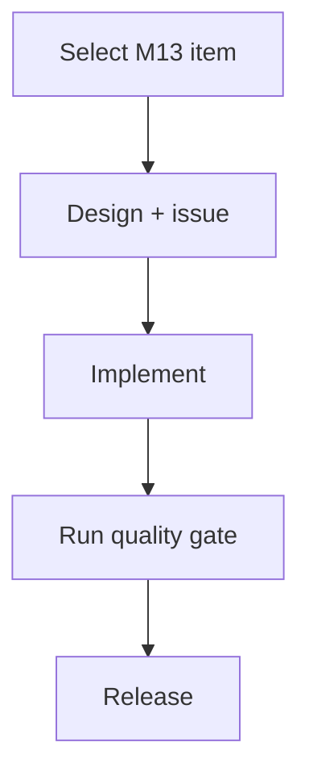

# nh-reader — Active Sprint Planning

> 🎯 **Living Source of Truth**: Active sprint roadmap, execution architecture, and completed sprint history for **NH Reader** (`nh-reader`).
> Pair with [`ROADMAP.md`](./ROADMAP.md) (direction), [`TODO.md`](./TODO.md) (task ledger), and [`BUGS.md`](./BUGS.md) (known issues).

> [!IMPORTANT]
> AI agents are strictly required to update this page and related tracking ledgers **before** executing new feature work or bug fixes and keep them synchronized.

---

## 📜 Tracking Rules

- **No Typo Duplication**: When recording user reports, clean and fix all typos to preserve professional quality.
- **Consistent Formatting**: Maintain consistent formatting and style throughout all documentation.
- **Clear Sectioning**: Use clear and descriptive headers for each section.
- **Active Items First**: The currently active sprint, task, or workstream must always be placed at the top of the content sections.
- **Active Sprints Only in Top Section**: `## 🎯 Active Sprints` must contain ONLY the currently active sprint(s). Once a sprint is completed, move it immediately to `## ✅ Completed Sprints` (newest first).
- **100% Active Direction Accuracy**: Continuously refine and synchronize sprint tasks with the current active direction; immediately update or remove superseded tasks.
- **Full History**: Every planned item from project history is represented under `## ✅ Completed Sprints`, newest first.
- **Explicit Project Tagging**: Every sprint header, task, and deliverable MUST be prefixed with `[nh-reader]`.
- **Tracking Docs Stay True**: Update `ROADMAP.md`, `TODO.md`, `BUGS.md`, and `PLAN.md` first or in lockstep with code changes.
- **Always Track Everything**: Every new feature request, enhancement, or bug report must be logged before execution.

---

## 🎯 Active Sprints

_No active sprint. Pick the next backlog item from [`TODO.md`](./TODO.md); the next planned cycle is Milestone M13 below._

---

## 🔮 Planned Sprints

The planned M13 execution path:



### ⏳ Sprint 2: `[nh-reader]` — Milestone M13 Enhancements
- **Project Identifier:** `[nh-reader]`
- **Repository Path:** `projects/nh-reader`
- `[nh-reader]` Tag frequency analytics and local recommendations from reading history.
- `[nh-reader]` Multi-profile library partitions (isolated blacklist/favorite spaces).
- `[nh-reader]` Background auto-update checker and GitHub release notification toasts.
- `[nh-reader]` Unified maintenance scripts standard (`main:sub:option`, `.mjs`).

### ⏳ Sprint 3: `[nh-reader]` — Native C++ Windows Architecture & Scope Reduction (Future, v1.0.0)
- **Project Identifier:** `[nh-reader]`
- **Repository Path:** `projects/nh-reader`
- **Objective:** Convert `nh-reader` from Tauri v2 into a pure native C++ Windows desktop application and reduce its scope purely to Windows.
- `[nh-reader]` Phase 1: Native C++20 Win32 & Direct2D / WinUI 3 architecture design and spike.
- `[nh-reader]` Phase 2: Native SQLite local cache and throttled network pipeline (WinHTTP/curl).
- `[nh-reader]` Phase 3: Hardware-accelerated paged & continuous gallery reader.
- `[nh-reader]` Phase 4: Retire Android and POSIX target code to streamline the codebase into a zero-overhead Windows app.

---

## ✅ Completed Sprints

### ✅ Sprint 1: `[nh-reader]` — Project-Local Ecosystem & Tracking Migration (2026-10-19)
- **Project Identifier:** `[nh-reader]`
- **Repository Path:** `projects/nh-reader`
- ✅ `[nh-reader]` Added the missing community-health files: `CODE_OF_CONDUCT.md`, `SUPPORT.md`, `GOVERNANCE.md`, and `.github/pull_request_template.md`.
- ✅ `[nh-reader]` Added a self-contained project-local agents ecosystem: `AGENTS.md`, `.agents/rules/local-conventions.md`, and `.github/copilot-instructions.md`.
- ✅ `[nh-reader]` Migrated project direction and work items into repo-local `ROADMAP.md`, `PLAN.md`, `TODO.md`, `BUGS.md`, and `HANDOFF.md`.
- ✅ `[nh-reader]` Refreshed stale repository URLs and removed external/workspace references from `CONTRIBUTING.md`, `SECURITY.md`, `PRIVACY.md`, `TOS.md`, `CITATION.cff`, and `.github/ISSUE_TEMPLATE/config.yml`.
- ✅ **Verification**: documentation-only changes; no build or runtime impact.

---

## 🛠️ Verification Commands

```powershell
npm run check        # svelte-kit sync + svelte-check (zero warnings)
npm run check:i18n   # locale parity
Push-Location src-tauri; cargo check; cargo test; Pop-Location
npm test             # full Rust + frontend + i18n gate
```

---

## 🔖 Metadata

- **Project**: nh-reader
- **Tracking Mode**: SemVer (`vMAJOR.MINOR.PATCH`)
