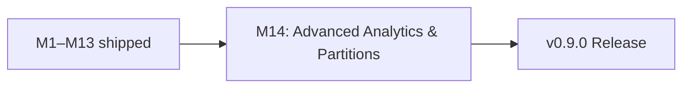

# nh-reader — Roadmap & Milestones

> 🗺️ **Living Source of Truth**: Product direction, positioning principles, and milestone delivery history for **NH Reader** (`nh-reader`).
> Pair with [`PLAN.md`](./PLAN.md) (sprint execution), [`TODO.md`](./TODO.md) (task ledger), and [`BUGS.md`](./BUGS.md) (issues and quirks).

> [!IMPORTANT]
> AI agents are strictly required to update this page and related tracking ledgers **before** executing new feature work or bug fixes and keep them synchronized.

---

## 📜 Tracking Rules

- **100% Active Direction Accuracy**: `ROADMAP.md`, `PLAN.md`, `TODO.md`, and `BUGS.md` must reflect the current active direction with zero contradictions. Immediately replace or remove superseded statements.
- **Zero External Mentions**: Never directly mention by name any external, third-party, or deleted projects or repositories.
- **No Typo Duplication**: When recording user reports or directives, clean and fix all typos to preserve professional quality.
- **Explicit Project Tagging**: Every milestone, sprint, task, or deliverable header and row MUST explicitly include the project name `[nh-reader]`.
- **Bare Minimal Completed Entries**: Keep this file focused on active and upcoming milestones; retain delivered milestones as concise one-line entries under Historical Milestones, with full narratives in `CHANGELOG.md`.

---

## 🔭 Vision & Positioning Principles

1. **Core Value Proposition**: A lightweight, modern, high-performance desktop client for nhentai.net built with Tauri v2 and Svelte 5, featuring fast search, zero-empty-space blacklist filtering, custom Fluent/System design, and a private local-first architecture.
2. **Design Principles**:
   - **Local-first privacy**: no accounts, telemetry, cloud sync, or third-party trackers; user data stays in local SQLite.
   - **Fast and fluent browsing**: responsive grids, streaming search, and a high-performance reader.
   - **Respectful integration**: throttle upstream requests and never hammer nhentai.net.
3. **Non-Goals & Boundaries**:
   - Not a content host or proxy service; all gallery data originates from nhentai.net.
   - No accounts, cloud sync, advertising, or analytics, and no abuse of upstream APIs.

---

## 🗺️ Milestone Overview

| # | Milestone | Status | Release / Target | Focus |
|---|---|---|---|---|
| **M1–M12** | `[nh-reader]` Core client & localization | ✅ Shipped | v0.1.0 – v0.7.5 | Foundation, browse, search, blacklist, SQLite cache, reader, storage budgets, 18-language i18n, title bar, NSIS installer, signing |
| **M13** | `[nh-reader]` Tauri v2 Performance Optimization, Browse Modernization & Native Docs | ✅ Shipped | v0.8.0 | Memory & cache optimizations, virtualized grid rendering, non-blocking image prefetching, zip/cbz pipeline speedups, browse navigation pivot, reader polish, and comprehensive native `docs/` |
| **M14** | `[nh-reader]` Advanced Analytics & Partitions | ⬜ Planned | v0.9.0 | Local reading history tag frequency analytics, recommendations, and multi-profile library partitions |

The delivery arc from shipped milestones to planned work:

---

## 🔮 Planned & Future Milestones

### `[nh-reader]` — Milestone M14: Advanced Analytics & Partitions
- ⬜ **Tag Frequency Analytics**: Local reading-history analytics showing top consumed tags, artists, and languages.
- ⬜ **Multi-Profile Partitioning**: Allow switching between isolated library/blacklist profile stores.
- ⬜ **Background Update Inspection**: Non-intrusive GitHub release notification check on app launch.

---

## 📌 Historical Milestones & Shipped Releases

### `[nh-reader]` — Milestones M1–M12 (v0.1.0 – v0.7.5)
- ✅ Core foundation, browse, advanced query search, blacklist stream buffering, SQLite cache,
  responsive reader, storage budgets, 18-language localization core, custom title bar,
  NSIS installer polish, and unified `npm run sign`.

---

## 🔖 Metadata

- **Project / Scope**: `nh-reader` — Tauri v2 desktop & Android reader (Rust + SvelteKit)
- **Tracking Mode**: SemVer (`vMAJOR.MINOR.PATCH`)
- **Governance**: Governed by this repository's `AGENTS.md`, `.agents/` rules, and `GOVERNANCE.md`.
