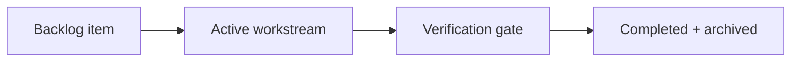

# nh-reader — Task Checklist & Workstream Tracking

> 📋 **Living Source of Truth**: Actionable task ledger for **NH Reader** (`nh-reader`).
> Statuses: ⬜ backlog · 🚧 in progress · ✅ done (tracked as `- [ ]` and `- [x]` checkboxes).
> High-level direction lives in [`ROADMAP.md`](./ROADMAP.md), active sprints in [`PLAN.md`](./PLAN.md), issues in [`BUGS.md`](./BUGS.md).

> [!IMPORTANT]
> AI agents are strictly required to update this page and related tracking ledgers **before** executing new feature work or bug fixes and keep them synchronized.

---

## 📜 Tracking Rules

- **No Typo Duplication**: When recording user reports, clean and fix all typos to preserve professional quality.
- **Consistent Formatting**: Maintain consistent formatting and style throughout all documentation.
- **Clear Sectioning**: Use clear and descriptive headers for each section.
- **Active Items First**: The currently active workstream must always be placed at the top of the content sections.
- **Improve & Categorize User Directives**: Rewrite user directives into clean, self-contained engineering requirements grouped by domain sub-headers. Never dump raw chronological chat quotes or leave contradictory superseded statements.
- **100% Active Direction Accuracy**: Whenever a requirement pivots or supersedes an earlier decision, replace the superseded directive in place across `ROADMAP.md`, `PLAN.md`, `TODO.md`, and `BUGS.md`.
- **Same-Change Updates**: When a task changes behavior or scope, update this file **in the same change**.
- **Done Moves Down**: When a workstream is done, check it off and archive detailed checklists to `.github/TODO-ARCHIVE.md`, leaving a concise single-line summary under Completed Workstreams.
- **Explicit Project Tagging**: Every workstream header, checklist group, and individual checkbox item MUST be prefixed with `[nh-reader]`.
- **Tracking Docs Stay True**: Update `ROADMAP.md`, `TODO.md`, `BUGS.md`, and `PLAN.md` first or in lockstep with code changes.
- **Always Track Everything**: Every new feature request, enhancement, or bug report must be logged before execution.

---

## 🔥 Active Workstreams

_No active workstream. Select the next item from the backlog below and move it here before starting._

Workstream flow:

---

## ⬜ Backlog / Candidate Tasks

### `[nh-reader]` — Milestone M13 Candidates
- [ ] `[nh-reader]` **Tag Frequency Analytics**: Local reading-history analytics showing top consumed tags, artists, and languages.
- [ ] `[nh-reader]` **Multi-Profile Partitioning**: Allow switching between isolated library/blacklist profile stores.
- [ ] `[nh-reader]` **Background Update Inspection**: Non-intrusive GitHub release notification check on app launch.
- [ ] `[nh-reader]` **Unified Scripts Standard**: Ensure all maintenance scripts follow canonical `main:sub:option` naming and `.mjs` conventions.

---

## ✅ Completed Workstreams & Archive

### ✅ `[nh-reader]` Workstream W.01: Project-Local Ecosystem & Tracking Migration (2026-10-19)
- **Project Identifier:** `[nh-reader]`
- **Repository Path:** `projects/nh-reader`

- [x] `[nh-reader]` Added `CODE_OF_CONDUCT.md`, `SUPPORT.md`, `GOVERNANCE.md`, and `.github/pull_request_template.md`.
- [x] `[nh-reader]` Added `AGENTS.md`, `.agents/rules/local-conventions.md`, and `.github/copilot-instructions.md`.
- [x] `[nh-reader]` Migrated `ROADMAP.md`, `PLAN.md`, `TODO.md`, `BUGS.md`, and `HANDOFF.md`.
- [x] `[nh-reader]` Refreshed stale URLs and removed external/workspace references from existing docs.

---

## 🔖 Metadata

- **Project**: nh-reader
- **Tracking Status**: Clean — no active workstream; M13 backlog ready.
