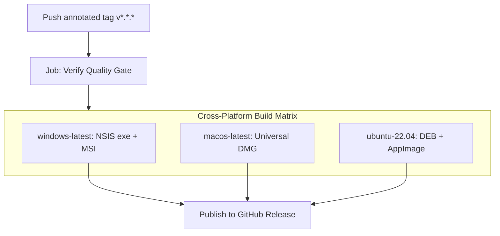

# Build & Release Engineering

NH Reader uses an automated, multi-platform build pipeline to compile, package, and distribute native binaries for Windows, macOS, and Linux.

---

## Local Production Builds

To compile and package a production release on your current host operating system:

```bash
npm run tauri build
```

The resulting artifacts will be output to:
`src-tauri/target/release/bundle/`

### Artifacts by Platform:
- **Windows**:
  - `nsis/nh-reader_<version>_x64-setup.exe` (Custom NSIS installer)
  - `msi/nh-reader_<version>_x64_en-US.msi` (MSI enterprise package)
- **macOS**:
  - `dmg/nh-reader_<version>_universal.dmg` (Universal binary for Intel & Apple Silicon)
  - `macos/NH Reader.app`
- **Linux**:
  - `deb/nh-reader_<version>_amd64.deb` (Debian/Ubuntu package)
  - `appimage/nh-reader_<version>_amd64.AppImage` (Portable AppImage)

---

## Continuous Integration & Release Pipeline

The release pipeline is defined in `.github/workflows/release.yml` and triggers automatically whenever an annotated Git release tag (`v*.*.*`) is pushed.



### Pipeline Stages

1. **Verify Job (`ubuntu-22.04`)**:
   - Executes `npm ci`.
   - Runs `npm run check` (Svelte/TypeScript validation with 0 errors and 0 warnings).
   - Runs `npm run check:i18n` (100% key parity across all locales).
   - Compiles static frontend via `npm run build`.
2. **Matrix Packaging**:
   - Compiles native binaries using platform-native toolchains.
   - Packages installers with custom icons and platform metadata.
3. **Asset Attachment**:
   - Uploads all compiled installer bundles directly to the corresponding GitHub Release.

---

## Version Bump Checklist

When preparing a new release:
1. Update version in `package.json` and run `npm install` to synchronize `package-lock.json`.
2. Update version in `src-tauri/Cargo.toml` and run `cargo check` in `src-tauri` to synchronize `src-tauri/Cargo.lock`.
3. Update version in `src-tauri/tauri.conf.json`.
4. Update version in `CITATION.cff`, `PRIVACY.md`, and `TOS.md`.
5. Add release notes section to `CHANGELOG.md` following [Keep a Changelog](https://keepachangelog.com/).
6. Create `.github/releases/v<version>.md` and `.github/discussions/announcements/v<version>.md`.
7. Commit changes and push annotated tag (`git tag -a v<version> -m "v<version> - summary"`).
